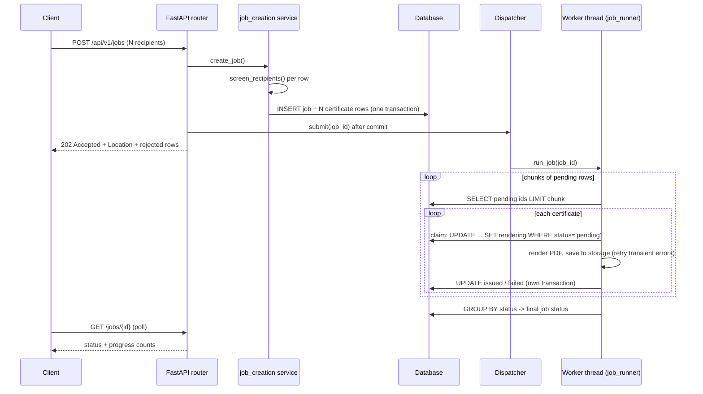
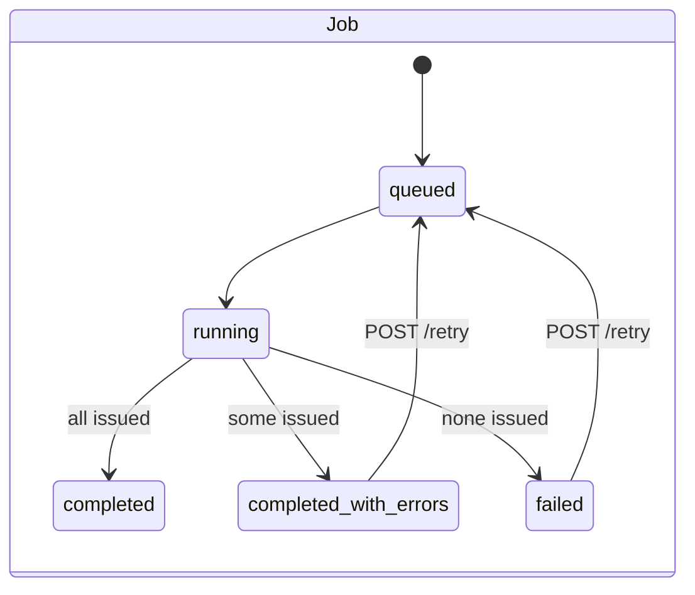
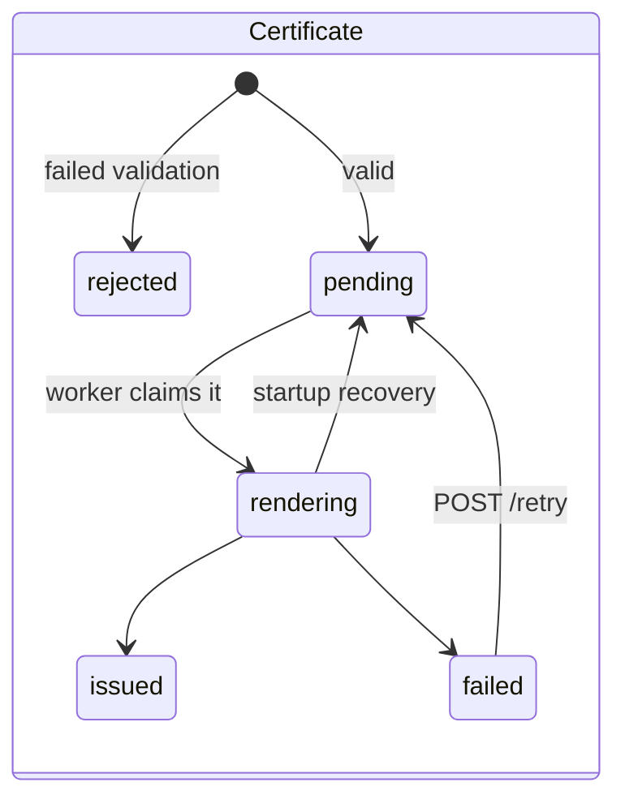

# Design

This document explains the decisions behind the service: what was chosen, what was
rejected, and what would change at a larger scale.

## 1. Request lifecycle at a glance



## 2. Synchronous vs background processing

**Decision: background processing. `POST` returns `202 Accepted` immediately.**

Rendering one certificate takes about 63 ms of CPU. With up to 5,000 recipients per
request, a synchronous request could take five minutes. Proxies and clients would time
out, a retry would duplicate work, and one slow request would tie up a server worker.

In the background design, `POST` validates, writes everything in a single transaction
and returns. It measures under 100 ms for 200 recipients, and its cost does not depend
on render time. The 200 certificates then take about 17 s on one worker thread
(about 85 ms each: 63 ms rendering plus three short database transactions). The client polls `GET /jobs/{id}` (via the `Location` header) and
fetches results when the job is done.

The cost of this choice is that clients must poll, and there's a window where the job
is accepted but not processed. A webhook callback would remove the polling; it's a
natural extension, but not needed here.

## 3. Thread pool instead of Celery and Redis

**Decision: a `ThreadPoolExecutor` owned by the FastAPI lifespan, behind a
`Dispatcher` protocol.**

| | Thread pool (chosen) | Celery + Redis |
|---|---|---|
| Moving parts | none beyond the app and DB | broker, worker processes, result backend |
| Local setup | `make run` | three processes, or docker compose |
| Durability | DB is the queue; recovery on startup | broker persistence, acks, visibility timeouts |
| Horizontal scale | one process | many workers on many machines |
| CPU parallelism | limited by the GIL | true multi-process |

For a take-home at this scale, Celery adds operational weight without fixing a real
problem. The design keeps the useful property Celery would give, **durability**,
because the dispatcher is only a trigger: it carries a job id, and all state lives in
the database. If the process dies, the executor's in-memory queue is lost, and that
doesn't matter, because startup recovery rebuilds it from the tables (section 7).

**The GIL caveat.** ReportLab rendering is CPU-bound Python, so threads interleave
instead of running truly in parallel. The pool still helps:
- several jobs make progress at once instead of queueing behind each other;
- database and disk I/O overlap with rendering;
- the API's event loop is never blocked by rendering.

For real CPU parallelism, the same `Dispatcher` protocol can be implemented with a
`ProcessPoolExecutor` or with separate worker processes (section 11). The routers and
services don't change.

**Tests use `InlineDispatcher`**, which runs the job inside `submit()`. Tests are
then deterministic, with no sleeping or polling, and the background path is still
covered by a dedicated thread-pool test.

## 4. Data model: one row per recipient

```
certificate_jobs   1 ──── N   certificates
(id, status, certificate        (id, job_id, position, recipient_name, recipient_email,
 details, serial_prefix,         status, serial, verification_code, file_key,
 idempotency_key, timestamps)    error_code, error_message, attempts, timestamps)
```

- **Every recipient gets a row at creation time, including rejected ones.** The
  database alone can then answer "what happened to position 17?" There's no separate
  error list to keep in sync, and the ZIP manifest is a single query.
- **`position`** is the index in the original request, with `UNIQUE(job_id, position)`.
  Clients match results back to their input by position, which works even when names or
  emails are duplicated or blank.
- **Progress is derived, not stored.** `GET /jobs/{id}` runs one
  `SELECT status, COUNT(*) ... GROUP BY status`, served by the `(job_id, status)`
  index. Stored counters such as `issued_count += 1` updated from several threads can
  drift: lost updates, or a crash between two writes. A count over the rows is always
  correct.
- **Serials** look like `BCG-2026-K7Q4-00042`: the issue year, a random per-job
  4-character Crockford base32 prefix (no `I L O U`, so a serial typed from paper is
  unambiguous), and the 1-based row number. The prefix column is `UNIQUE`; on a
  collision (about 1 in a million per pair of jobs) creation retries with a new prefix.
- **Verification codes** are 128-bit `secrets.token_urlsafe` values. The code is the
  only secret behind the public `/verify` URL, so it must be unguessable. Serials are
  human-friendly but guessable, which is why they are not used for verification.
- **Enums are `VARCHAR` plus a `CHECK` constraint**, not native Postgres enums. SQLite and
  Postgres then behave identically, and adding a status is a simple migration instead
  of an `ALTER TYPE`.
- **UTC everywhere.** A `UtcDateTime` column type rejects naive datetimes and re-attaches
  UTC on SQLite, which has no timezone support.

## 5. Two levels of validation

| Level | Examples | Outcome |
|---|---|---|
| **Request** | malformed JSON, missing/blank `title`, empty `recipients`, more than `MAX_RECIPIENTS_PER_JOB` | `422`, nothing stored |
| **Recipient** | blank name, name over 120 characters, control characters, invalid email, duplicate email in the job | row stored as `rejected` with `error_code` and `error_message`; the rest of the job proceeds |

**Why recipient fields are plain strings in the schema.** If `RecipientInput.email`
were Pydantic's `EmailStr`, a single bad address would make Pydantic reject the whole
5,000-row request with a 422, which is exactly the all-or-nothing behaviour the
assignment rules out. So the schema accepts `name: str | None` and
`email: str | None`, and `services/recipient_validation.py` checks each row. Even a
missing field becomes a rejected row, not a failed request.

Rules run in a fixed order, and the first failure is recorded, so every rejected row
has exactly one machine-readable code:

`NAME_BLANK -> NAME_CONTROL_CHARACTERS -> NAME_TOO_LONG -> EMAIL_INVALID -> EMAIL_DUPLICATE`

Normalisation happens before the checks:
- Names: Unicode NFC (so `e` plus a combining accent equals `é`, which matters for
  fonts and comparisons), then trim and collapse internal whitespace.
- Emails: trim and lower-case.

Control characters are detected on the raw value, because whitespace-collapsing would
otherwise hide an embedded tab. Duplicates are case-insensitive. The first occurrence
is accepted, later ones point back to it ("duplicate of position 0"). A rejected row
never claims an email, so it can't block a later valid row.

Email syntax uses `email-validator` with `check_deliverability=False`. DNS lookups
would make validation slow and non-deterministic, and deliverability is the mail
system's concern.

**Strict mode** (`?strict=true`) is for clients that want all-or-nothing behaviour.
Any invalid row refuses the request with `422 INVALID_RECIPIENTS`, and `details` lists
**every** bad row, so the client can fix them in one pass.

## 6. State machines

Both machines are defined once, in `certgen/domain/statuses.py`, as an enum plus an
allowed-transitions map. Every status change goes through `transition_job()` or
`transition_certificate()`, which raise `InvalidTransition` for an illegal move.





- **The final job status is computed from counts** (`final_job_status()`), with one
  rule: "nothing issued" is `failed`, even if every row was only rejected. From the
  client's point of view, the job produced no certificates.
- A job with zero valid rows still goes through `running`, so there's exactly one
  finalisation code path.
- **Claiming a row is a compare-and-set:**
  `UPDATE certificates SET status='rendering' WHERE id=:id AND status='pending'`.
  If two workers race for the same row (for example a retry overlapping a recovery),
  only one sees `rowcount = 1`. A certificate is therefore never rendered twice, and
  this works the same on SQLite and Postgres without row locks.

## 7. Failure isolation, retries and crash recovery

**Isolation.** `services/certificate_issuing.py` processes one certificate in three
short steps, each with its own transaction:

1. **Claim** `pending -> rendering`, then commit. The row is now visibly in progress.
2. **Render and store**, with no database session open. Rendering is the slow part, and
   holding a connection (or, on SQLite, a write lock) during it would block everything
   else.
3. **Record** `issued` (with `file_key`) or `failed` (with `error_code` and
   `error_message`), then commit.

Every exception in step 2 is caught and written to that row. Nothing propagates to
the job loop, so one bad certificate can't stop the others.

**Retry policy.**

| Error type | Examples | Behaviour | Final `error_code` |
|---|---|---|---|
| Transient (`OSError` and its subclasses) | disk full, network share hiccup, timeout | retried up to `MAX_RENDER_ATTEMPTS` (3) with exponential backoff `0.5s, 1s, ...` | `TRANSIENT_ERROR` |
| Deterministic (anything else) | bad data, a ReportLab error | fails immediately: the same input would fail the same way | `RENDER_ERROR` |

`attempts` is stored on the row. The backoff `sleep` is injected, so tests check the
exact schedule (`[0.5, 1.0]`) without actually sleeping.

`POST /jobs/{id}/retry` re-queues `failed` rows only. `rejected` rows would fail the same
way again; they need corrected input in a new job.

**Crash recovery** (`services/startup_recovery.py`, run in the lifespan before the
app serves requests):

1. Reset every `rendering` row to `pending`. Its outcome was never recorded, so
   redoing it is safe: storage writes are atomic and keyed by serial, so a re-render
   just overwrites the same file.
2. Re-submit every `queued` or `running` job to the dispatcher.

The job runner asks the database for pending rows in chunks (`PROCESSING_CHUNK_SIZE`)
instead of iterating an in-memory list, so running it again simply continues where it
stopped.

**Infrastructure failures** are the one case not isolated per row. If the database
itself goes away mid-job, the runner thread stops and logs the crash. Rows it had
claimed stay `rendering`, and the job stays `running` until the next startup's
recovery. This is deliberate: retrying in a tight loop against a dead database helps
nobody.

## 8. Storage abstraction

```python
class CertificateStorage(Protocol):
    def save(self, job_id: UUID, serial: str, pdf_bytes: bytes) -> str: ...  # returns file_key
    def read(self, file_key: str) -> bytes: ...
```

- `LocalDiskStorage` writes `storage/{job_id}/{serial}.pdf`. It writes to a temp file,
  then `os.replace()`s it into place. The rename is atomic, so a crash never leaves a
  half-written PDF under the final name.
- `file_key` is opaque to the rest of the system. An S3 implementation would return
  the object key, and nothing else would change.
- `read()` refuses any key that resolves outside the storage root, so a corrupted key
  can't be used to read arbitrary files.

The renderer works the same way: a `CertificateRenderer` protocol
(`render(RenderContext) -> bytes`). Both are injected in `certgen/composition.py`, the
single place that chooses implementations. Tests pass a renderer that raises for one
named recipient, or a storage that fails N times. Production code contains no
`if testing:` branches.

## 9. Idempotency

Clients may send `Idempotency-Key: <string up to 128 characters>` with `POST /jobs`:

- The key is stored in a `UNIQUE` column, together with a SHA-256 **fingerprint** of
  the canonical request body.
- Same key, same body: `200 OK` with the original job and `Idempotent-Replayed: true`.
  Nothing is re-created or re-rendered.
- Same key, different body: `409 IDEMPOTENCY_KEY_REUSED`. Silently returning a job for
  different data would hide a client bug. Stripe uses the same convention.
- Two concurrent requests with the same new key: the `UNIQUE` constraint lets one
  insert win. The loser catches the `IntegrityError` and returns the winner's job.

## 10. Retrieval

- **Pagination is keyset-based on `position`**, using an opaque base64 cursor
  (`WHERE position > :cursor ORDER BY position LIMIT n+1`). Unlike `OFFSET`, it stays
  fast deep into a big job and never skips or repeats rows while workers change
  statuses. Fetching `n+1` rows tells us whether a next page exists without a `COUNT`.
- **PDF download** returns `404 CERTIFICATE_NOT_ISSUED` (with the current status in
  `details`) for rows that exist but have no file. `Content-Disposition` sends an
  ASCII `filename` (accents folded, unsafe characters removed) and a UTF-8
  `filename*` (RFC 6266). Quotes, slashes, semicolons and newlines in a name can't
  inject headers or paths.
- **The ZIP is streamed.** Rows are first snapshotted into plain dataclasses while the
  request's session is open. The generator then writes to a non-seekable sink, so
  `zipfile` uses data descriptors, and yields each entry as soon as it's written.
  Memory holds at most one PDF, and the streaming code never touches the database
  after the request scope ends. PDFs are `ZIP_STORED` (they're already compressed); the
  manifest is deflated.
- **`manifest.csv` covers every row**, including failed and rejected ones, so the
  archive alone accounts for the whole request. Cells starting with `= + - @` are
  prefixed with `'`, because a recipient name like `=HYPERLINK(...)` would otherwise run
  as a formula when the manifest is opened in Excel (CSV injection).

## 11. Certificate design

**Concept: "engraved security print".** It borrows the visual language of banknotes and
old share certificates (guilloche rosettes, microtext borders, registration marks)
and sets it in a modern, minimal, asymmetric layout. There are no ribbons, gold
gradients, clipart or script fonts.

- **Palette:**
  - ivory `#F4EFE4` paper
  - deep ink `#1C2541`
  - teal `#3A7D7B`, only as fine hairlines
  - vermilion `#C4492D`, only for the serial number and the seal's centre
- **Type:**
  - Cormorant Garamond SemiBold for the name, Italic for the achievement line
  - IBM Plex Sans Condensed, letter-spaced uppercase, for labels
  - IBM Plex Mono for data: serial, date, microtext. Cormorant's old-style figures make
    "11" read like "II", so dates are set in mono.
- **The rosette is a function of the serial.**
  - SHA-256 of the serial supplies a few bytes, which pick lobe counts, number of
    rotated copies, lobe depth and rotation, each clamped to a range that always looks
    good.
  - Each ring is a hypotrochoid or epitrochoid:
    `x = a*cos(t) ± b*cos(n*t)`, `y = a*sin(t) − b*sin(n*t)`.
    With an integer `n` it closes after one turn, and `a + b = radius` makes each ring
    fit its circle exactly.
  - The same serial always gives the same seal, and 200 consecutive serials give 200
    distinct seals; both are tested.
- **Layout:**
  - The seal sits in the left third. The text block is left-aligned in the right two
    thirds, laid out first, then centred vertically on the seal, so a one-line and a
    two-line name both look composed.
  - The bottom row holds the serial (under the seal it was generated from), the
    signatory, the date and the QR code.
- **Long names never overflow:**
  1. one line, shrinking from 48pt to 30pt;
  2. then two balanced lines from 36pt to 18pt;
  3. then a hard floor of 6pt (character-level breaking as the very last resort).

  Validation caps names at 120 characters, and tests check fitted width ≤ column width
  for pathological names.
- **Glyph coverage:** if Cormorant lacks a glyph, the whole string switches to the
  bundled Noto Serif. Switching faces mid-word looks broken, so the switch applies to
  the whole string.
- **Every measurement** lives in `rendering/design_tokens.py`.
- **Performance:** about 63 ms per certificate, 188 KB per PDF. Profiling showed half
  the original 142 ms went to ReportLab's pure-Python ASCII85 encoding and number
  formatting. Fixes: binary streams (`rl_config.useA85 = 0`), the `rl_accel` C
  extension, and sampling the background wave field at 8pt instead of 4pt.

## 12. Known limitations

- **Single process.** One API process owns the thread pool. Running several replicas
  works for the API, but each replica's startup recovery would re-dispatch the same
  unfinished jobs. The compare-and-set claim keeps that correct (no double renders),
  but it's wasteful. Section 13 fixes this properly.
- **GIL-bound rendering**, as explained in section 3.
- **Scripts beyond Latin, Greek and Cyrillic** (for example CJK or Arabic) are not
  covered by either bundled face and render as missing-glyph boxes. Fixing this means
  bundling Noto Sans CJK (large) or picking a face per script. Right-to-left text would
  also need shaping, which ReportLab doesn't do.
- **Migrations at startup** are convenient for local runs but racy with many replicas.
  Set `RUN_MIGRATIONS_ON_STARTUP=false` and run `alembic upgrade head` as a deploy
  step.
- **No authentication or rate limiting.** Out of scope; they would sit in front of the
  routers as dependencies or middleware.
- **No retention policy.** PDFs and rows live forever.
- **QR codes are not decoded in tests.** That would need a decoder library with native
  dependencies. The test suite asserts the verification URL passed to the renderer
  instead.

## 13. Scaling to 1,000,000 certificates

What changes, in order of need:

1. **Separate workers from the API.** Run N worker processes (`python -m certgen.worker`)
   that loop: claim a batch, render, record. Each claims with
   ```sql
   SELECT id FROM certificates
   WHERE status = 'pending'
   ORDER BY job_id, position
   LIMIT 100
   FOR UPDATE SKIP LOCKED;
   ```
   then sets those rows to `rendering`. `SKIP LOCKED` lets many workers pull disjoint
   batches from the same table without contention. Postgres becomes the queue, and
   rendering scales across cores and machines.
2. **Lease-based recovery instead of startup recovery.** Add `claimed_at` and
   `worker_id`, and reset rows whose lease expired (say five minutes). Then any number
   of workers can start and stop at any time.
3. **A real queue when fan-out or priorities matter.** SQS, RabbitMQ or Celery, with
   one message per chunk of ids. The `Dispatcher` protocol is the seam; the database
   stays the source of truth and messages remain triggers.
4. **Object storage.** An S3/GCS implementation of `CertificateStorage`. Downloads
   return **presigned URLs** (a 302 redirect, or a `download_url` field), so PDF bytes
   never pass through the API. ZIPs of 100k files are built by a background job into
   object storage, not streamed per request.
5. **Bulk writes.** Insert recipient rows with `COPY` or multi-row `INSERT` in batches,
   and accept large recipient lists as an uploaded CSV instead of one JSON body.
6. **Progress at scale.** `GROUP BY` over 1M rows is still fast with the
   `(job_id, status)` index. If not, keep counters updated in the same transaction as
   each row change (still exact, never drifting) or cache the counts for a few seconds.
7. **Rendering cost.** Cache the static page layers (paper, waves, frames) as a PDF
   form XObject and draw only the per-certificate parts. That cuts render time and file
   size substantially.
8. **Partitioning and retention.** Partition `certificates` by `job_id` hash or by
   creation month, and archive old jobs.
