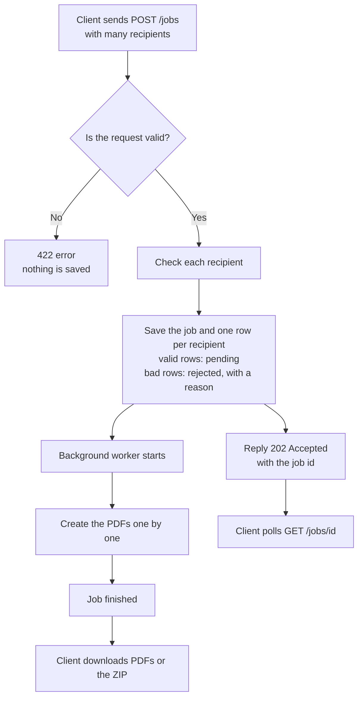
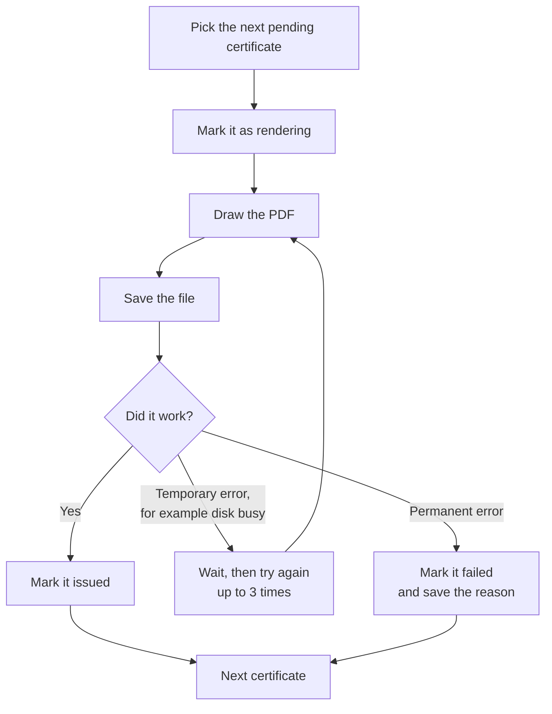
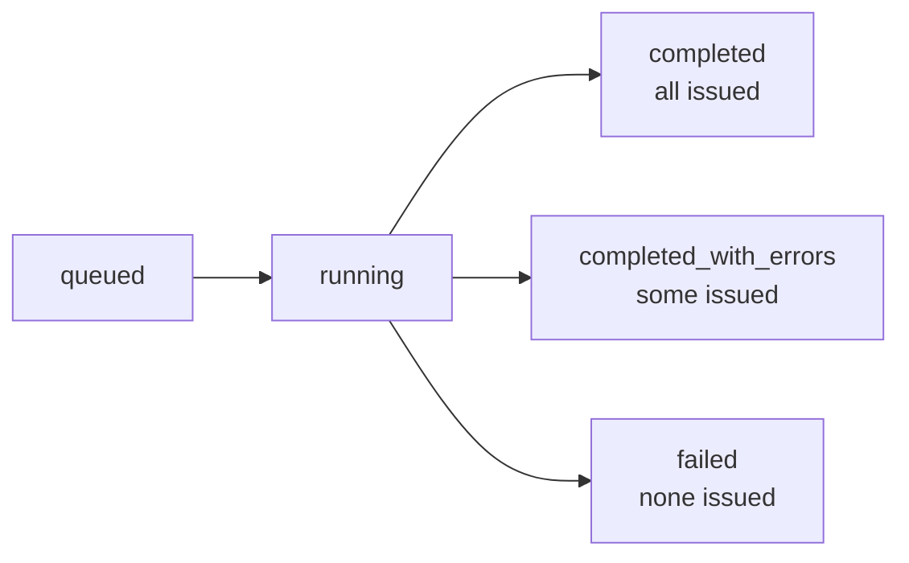

<div align="center">


# Bulk Certificate Generator

Send **one request with many people** and get **one PDF certificate for each person**.

Built with FastAPI · SQLAlchemy · PostgreSQL or SQLite · ReportLab


</div>

---

## What it does

1. You send a list of recipients (name and email) plus the certificate details.
2. The API checks every recipient and saves the job right away.
3. Certificates are created in the background, one PDF per valid recipient.
4. You check progress and download the PDFs, one at a time or all together as a ZIP.

If one recipient has bad data, only that recipient is skipped. Everyone else still
gets a certificate.

---

## The main flow



---

## How each certificate is made



Each certificate is saved on its own, so one failure never stops the others.

---

## Status of a job



## Status of each certificate

| Status | Meaning |
|---|---|
| `rejected` | Bad input (empty name, invalid or duplicate email). Never created. |
| `pending` | Waiting to be created |
| `rendering` | Being created right now |
| `issued` | Done; the PDF can be downloaded |
| `failed` | Creating it went wrong; the reason is saved |

---

## Run it

> Needs Python 3.11 or newer. It uses SQLite by default, so there's nothing else to set up.

```bash
make install
```

```bash
make run
```

Open **http://localhost:8000/docs** to try the API in your browser.

Run the tests (94 tests, about 4 seconds):

```bash
make test
```

<details>
<summary>Run with PostgreSQL using Docker</summary>
<br>

```bash
docker compose up --build
```

</details>

---

## Try it in 4 steps

**1. Submit a job.** The sample has 7 people: 4 valid and 3 with mistakes.

```bash
curl -s -X POST http://localhost:8000/api/v1/jobs \
  -H "Content-Type: application/json" \
  --data @examples/sample_request.json
```

The response gives you a `job_id`, and tells you right away which rows were rejected
and why.

**2. Check progress**

```bash
curl -s http://localhost:8000/api/v1/jobs/<job_id>
```

```json
"status": "completed_with_errors",
"progress": {"total": 7, "issued": 4, "rejected": 3, "failed": 0, "percent_complete": 100.0}
```

**3. See the result for each person**

```bash
curl -s http://localhost:8000/api/v1/jobs/<job_id>/certificates
```

| # | Status | Serial or reason | Name |
|:---:|:---:|---|---|
| 0 | issued | BCG-2026-FJKS-00001 | Ada Lovelace |
| 1 | issued | BCG-2026-FJKS-00002 | José Müller |
| 2 | issued | BCG-2026-FJKS-00003 | Zoë Ångström-Núñez Łukasiewicz |
| 3 | issued | BCG-2026-FJKS-00004 | Maximilian … Wittelsbach |
| 4 | rejected | NAME_BLANK | *(empty)* |
| 5 | rejected | EMAIL_INVALID | Grace Hopper |
| 6 | rejected | EMAIL_DUPLICATE | Ada Again |

**4. Download**

```bash
curl -s -OJ http://localhost:8000/api/v1/certificates/<certificate_id>/pdf
```

```bash
curl -s -o certificates.zip http://localhost:8000/api/v1/jobs/<job_id>/archive.zip
```

The ZIP contains every PDF plus `manifest.csv`, which lists every person and their
status.

---

## All endpoints

| Method | Path | What it does |
|:---:|---|---|
| POST | `/api/v1/jobs` | Submit many recipients |
| GET | `/api/v1/jobs/{job_id}` | Job status and progress |
| GET | `/api/v1/jobs/{job_id}/certificates` | Result for each recipient |
| GET | `/api/v1/jobs/{job_id}/archive.zip` | Download all PDFs as a ZIP |
| POST | `/api/v1/jobs/{job_id}/retry` | Try failed certificates again |
| GET | `/api/v1/certificates/{certificate_id}` | Details of one certificate |
| GET | `/api/v1/certificates/{certificate_id}/pdf` | Download one PDF |
| GET | `/api/v1/verify/{code}` | Check a certificate is real (the QR code links here) |
| GET | `/healthz` | Health check |

Every error has the same shape:

```json
{"error": {"code": "JOB_NOT_FOUND", "message": "No job with id ...", "details": []}}
```

---

## Key decisions (short version)

| Decision | Reason |
|---|---|
| Create certificates **in the background** | A big list would take too long in one request; the API replies in under 100 ms |
| **Thread pool**, not Celery | Simple to run; the database keeps all the state |
| **One database row per recipient** | You can see exactly who succeeded and who failed |
| **Bad rows are rejected, not the whole request** | One typo shouldn't block 5,000 certificates (use `?strict=true` to reject everything) |
| **Resume after restart** | Unfinished work is picked up again automatically on startup |
| **Idempotency-Key header** | Sending the same request twice doesn't create duplicates |

Full details are in [DESIGN.md](DESIGN.md). A code walkthrough is in
[INTERVIEW_NOTES.md](INTERVIEW_NOTES.md).

---

## Certificate design

Every certificate has a seal pattern generated from its serial number, so each one
is unique:

<div align="center">

</div>

Long names shrink, then wrap to two lines, and accented names render correctly.
Sample PDFs: [short name](samples/short_name.pdf) ·
[long name](samples/long_name.pdf) · [accented name](samples/accented_name.pdf)

---

## Project structure

```
certgen/
├── api/         routes (thin, no business logic)
├── services/    the main logic: create jobs, validate, generate, download
├── domain/      statuses and serial numbers
├── models/      database tables
├── dispatch/    background worker (thread pool)
├── rendering/   PDF design
└── storage/     where PDFs are saved
tests/           94 tests
```
